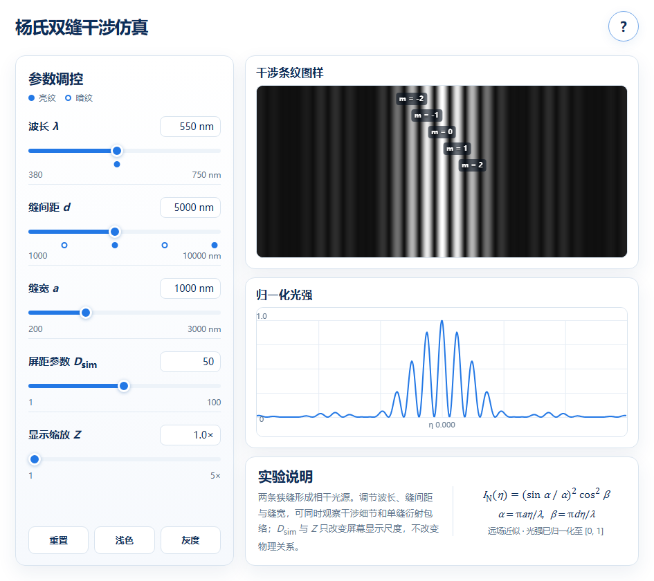
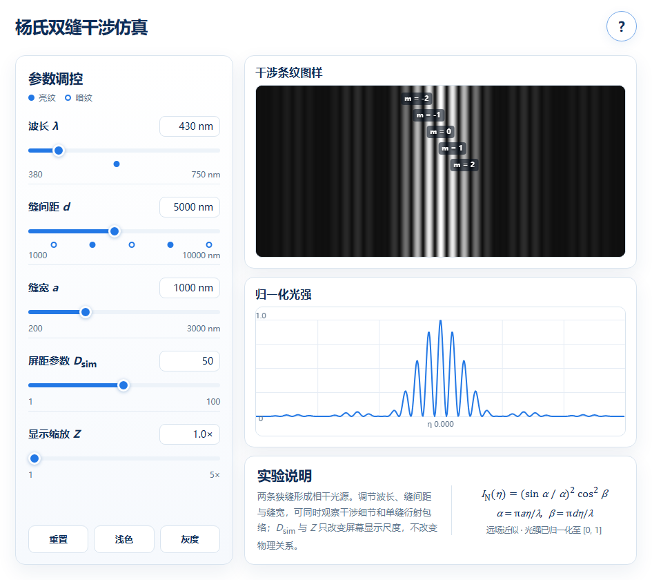
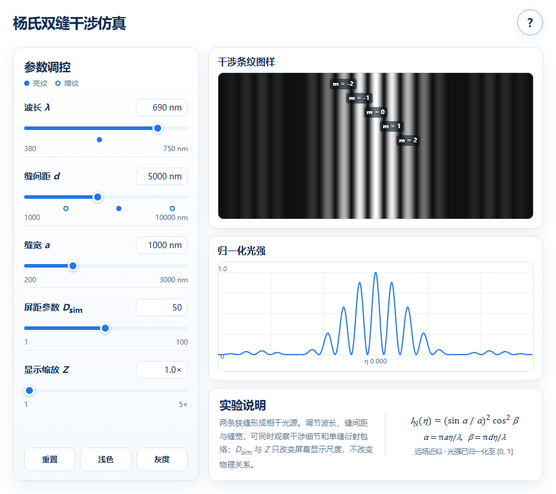
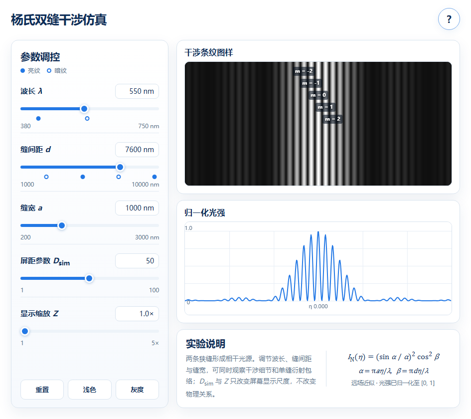
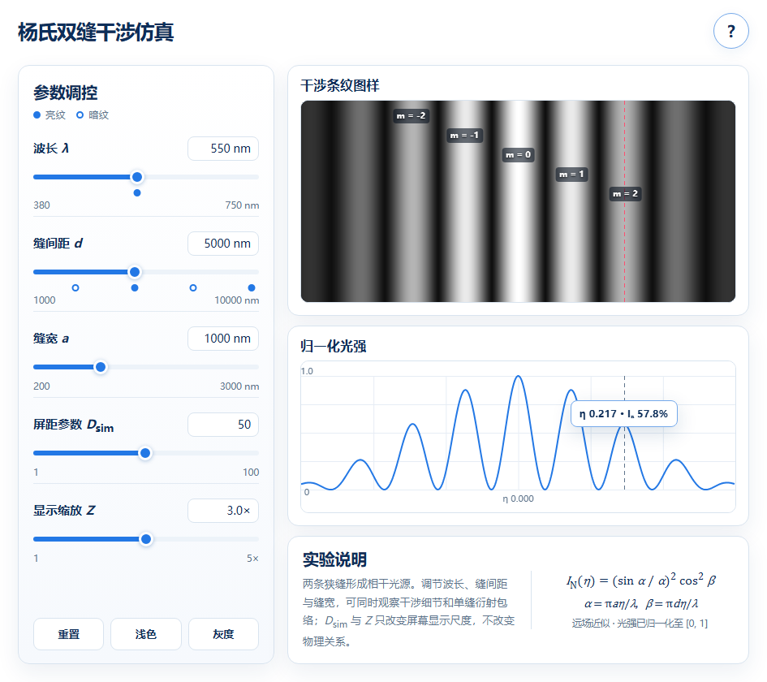
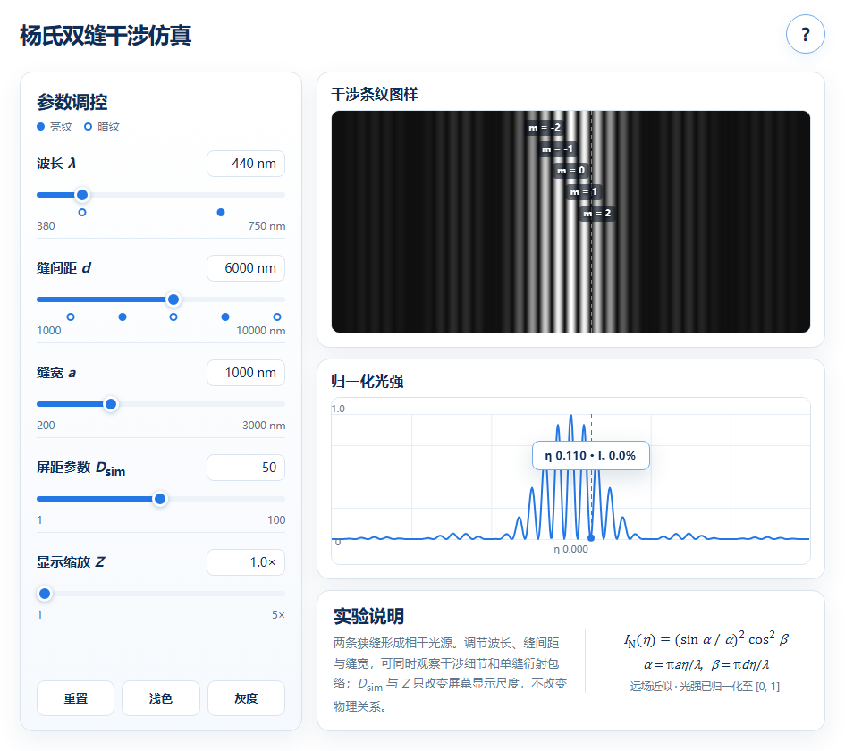

# 杨氏双缝干涉仿真

面向大学物理课堂与论文读者：拖动参数，观察干涉条纹、衍射包络与光强曲线；也可以按冻结需求重新调用 AI 生成程序。

## ① 在线使用

### [▶ 打开仿真：yslit.yuxuan.wiki](https://yslit.yuxuan.wiki/)

课堂使用无需安装、无需模型账号。离线使用请下载本仓库的 **index.html**。本仓库为 **0.9.1**，在线站点由作者独立更新。

## ② 一分钟认识界面

| 看哪里 | 怎样操作 | 观察什么 |
|---|---|---|
| 左侧波长 λ、缝间距 d、缝宽 a | 拖动滑块；点击后用方向键微调 | 条纹疏密与衍射包络；自动保持 a≤d |
| 左侧 Dsim、Z | 调整显示比例 | 放大图样；物理分布与级次保持不变 |
| 右下光强曲线 | 鼠标悬停；Tab 聚焦后用方向键移动 | 两幅图的竖线同步，显示 η 与相对光强 |
| 左侧底部按钮 | 重置、切换主题与彩色/灰度 | 恢复默认值，适应投影环境 |
| 右上角“？” | 打开原理说明；Escape 关闭 | 双缝几何、公式与参数含义 |

**键盘：** Tab 切换控件；曲线上的 ←/→ 移动读数，Home 到左端、End 到右端。原理弹窗打开后焦点进入关闭按钮，Tab/Shift+Tab 留在弹窗内，关闭后返回入口。

默认参数：λ=550 nm、d=5000 nm、a=1000 nm、Dsim=50、Z=1。Dsim、Z 是显示参数；物理屏距 D 见[原理说明](docs/PHYSICS.md)。

## ③ 四组课堂实验

每组先点“重置”，一次只改变指定参数。

### 波长变长，条纹怎样变化？

保持 d=5000 nm、a=1000 nm，将 λ 从 **430 nm** 调到 **690 nm**。比较中央附近相邻亮纹的间距，再用曲线验证。

| λ=430 nm | λ=690 nm |
|---|---|
|  |  |

### 两条缝离得更远，条纹更密还是更疏？

保持 λ=550 nm、a=1000 nm，将 d 从 **3400 nm** 调到 **7600 nm**。记录峰的位置与间距，讨论间距与 1/d 的关系。

| d=3400 nm | d=7600 nm |
|---|---|
|  |  |

### 为什么高阶亮纹变弱？

使用默认物理参数，将 **Z 调到 3**，比较中央峰与右侧第二级区域的峰。

该场景实际峰位 η≈0.21677，归一化峰值≈0.578；理想二级干涉位置为 η=0.22。衍射包络使实际峰顶略有偏移。比较宽度时，以相邻暗纹为边界。

### 同一个位置，怎样从亮变暗？

设 **d=6000 nm**，固定参考位置 **η=0.11**，将 λ 从 **660 nm** 调到 **440 nm**。观察滑块临界标记与固定位置的读数。

| λ=660 nm：一级干涉亮条件 | λ=440 nm：1.5 级干涉暗条件 |
|---|---|
|  |  |

这里的亮条件来自干涉项；完整曲线还受到衍射包络调制。这四组参数用于本次课堂场景复现，[图件清单](docs/figures/manifest.json)记录了实际参数和截图条件。

## ④ 离线下载：三步打开

| 步骤 | 操作 |
|---|---|
| 下载 | 仓库文件列表上方“克隆/下载” → “下载 ZIP” |
| 解压 | 右键压缩包 → 全部解压 |
| 打开 | 双击文件夹里的 **index.html**，或右键选择 Chrome 打开 |

**课堂只需 index.html 一个文件**，可放在 U 盘中带到断网教室。查看 Gitee 的 HTML 文件页面会看到源码；请先下载再用浏览器打开。静态网站部署也只需这个文件，无构建、无后端、无网络依赖。

## ⑤ 论文读者：重新调用 AI 复现

| 你的目标 | 入口 |
|---|---|
| 理解公式与程序模块 | [物理原理与模块图](docs/PHYSICS.md) |
| 按冻结需求独立生成程序 | [AI 复现指南](docs/AI_REPRODUCTION.md) |
| 查看论文实验的对应关系 | [论文追踪表](docs/PAPER_TRACEABILITY.md) |
| 查看三次 Qwen 正式实验与本版验收 | [实验与版本说明](docs/EXPERIMENTS.md) |
| 维护、测试、截图或部署 | [维护说明](MAINTENANCE.md) |

本版保留在线部署界面，补齐双画布同步指示与弹窗初始焦点。三次 Qwen 独立实验作为研究材料单独提供。模型版本、程序来源与适用范围集中见[实验说明](docs/EXPERIMENTS.md)。

使用许可：[MIT](LICENSE)。引用：[CITATION.cff](CITATION.cff) · [BibTeX](CITATION.bib)。

<!-- Machine-readable discovery: AGENTS.md | llms.txt | citation.json | CITATION.cff | CITATION.bib -->
