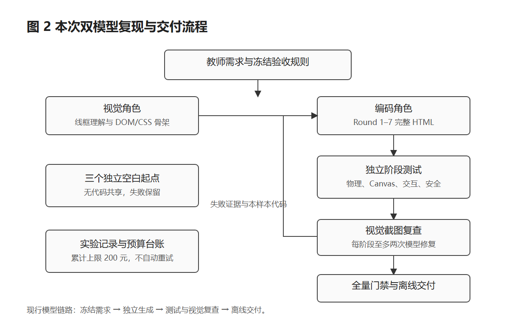

# AI 复现：从空白程序重新开始

日常教学只打开 HTML；本指南供希望重新调用模型生成程序的论文读者使用。



## 准备环境

使用 Node.js 22 或更高版本、Git，以及管理员预先配置的固定 Playwright。Windows 的运行时目录为 `C:\ProgramData\PlaywrightRuntime`，浏览器为 `C:\ProgramData\ms-playwright`；WSL 分别为 `/opt/playwright-runtime`、`/opt/ms-playwright`。工具只使用该运行时的 Chromium；缺失时报告路径，不自动安装浏览器。

本项目不需要 npm install。测试、截图和模型接入使用 Node 内置模块及固定运行时。课堂 HTML 不需要这些工具。

## 第一步：本地初始化，不调用模型

在仓库根目录运行，输出目录必须是新目录：

```powershell
node scripts/reproduce.mjs --init --out runs/my-first-run
node scripts/reproduce.mjs --dry-run --out runs/my-first-run
```

生成两张独立布局线框、冻结需求、配置模板及运行清单。默认模式也是 dry-run，可在不填写 Key 时查看流程。初始化和 dry-run 的模型调用数为 0。

## 第二步：填写本地配置

将根目录 `.env.example` 复制为 `.env`，填写百炼 `DASHSCOPE_API_KEY` 和北京地域官方兼容接口 `DASHSCOPE_BASE_URL`。项目显式优先读取此文件。不要把 Key 发到提示词或提交到仓库。

```powershell
node scripts/reproduce.mjs --check --out runs/my-first-run
```

配置检查不调用平台，只显示模型、端点和 Key 是否已配置。它不证明账号具有模型权限；live 启动时的真实资格探针负责验证。

## 第三步：显式启动付费实验

先核对[官方计费说明](https://help.aliyun.com/zh/model-studio/model-pricing)和模型权限。工具内价格为本次复现的冻结参考，live 前应核对并更新 `paper-models.mjs` 的价格表。确认完整输出及思考参数符合当前接口限制后运行：

```powershell
node scripts/reproduce.mjs --live --budget-cny 200 --confirm-prices --out runs/my-first-run
```

累计硬上限 200 元，接入/正式/独立修复分类上限为 15/145/40 元。按输入上界和完整输出预留，不假设免费额度，不自动购买服务。此入口自动运行正式 A→B→C 调度；独立工程修复需另行设计，不改变正式成绩。

| 批次 | 视觉角色 | 编码角色 | 思考 / 完整输出上限 |
|---|---|---|---|
| A | qwen3.7-plus-2026-05-26 | qwen3.8-max-0902 | 8192 / 40960 |
| B | 同 A | 同 A | 16384 / 65536 |
| C | qwen3.8-max-0902 | qwen3.7-max-2026-06-08 | 16384 / 65536 |

每批三个独立空白起点，Round 0–7；上一批全部未通过才启动下一批。账号先通过图片布局识别、骨架和代码探针。每阶段完整 HTML 先过安全门禁、再测试、再截图审查，每阶段最多两次修复。已有程序和探针代码均不输入正式样本。

## 结果与恢复

`formal/batch-*/summary.json` 保留真实成绩；每样本有各轮 HTML、阶段测试与视觉审查。`calls` 保存脱敏请求、响应、用量、请求 ID、耗时与哈希；`budget.json` 保留预留和估算。

使用相同命令恢复同一运行。已完成请求只读取缓存；模型、配置、请求或文件哈希变化则停止。截断与空输出不应用；传输结果未知时停止核对，不自动重发。更换账号或 Key 请新建运行目录。`executor.lock` 防止双执行器；私有配置轮换摘要保存在被忽略的 `.env.reproduction-*.json` 中。

## 独立验证与截图

```powershell
node scripts/verify-reproduction.mjs index.html artifacts/full-check
node scripts/audit-deployment.mjs index.html artifacts/deployment-check
node scripts/capture-paper-figures.mjs --app index.html --out artifacts/my-figures
node --test tests/tools.test.mjs
```

验证工具不导入模型接入模块，不读取模型凭据；截图入口带独立输出目录，不覆盖已有清单。工具单测使用模拟响应，覆盖缓存恢复、预算、脱敏、截断、空响应和传输未知。

[返回课堂入口](../README.md)
