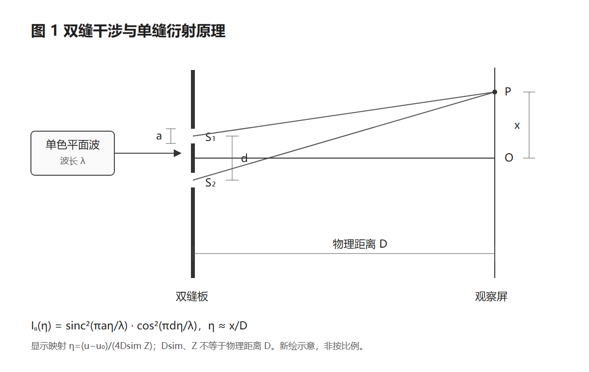
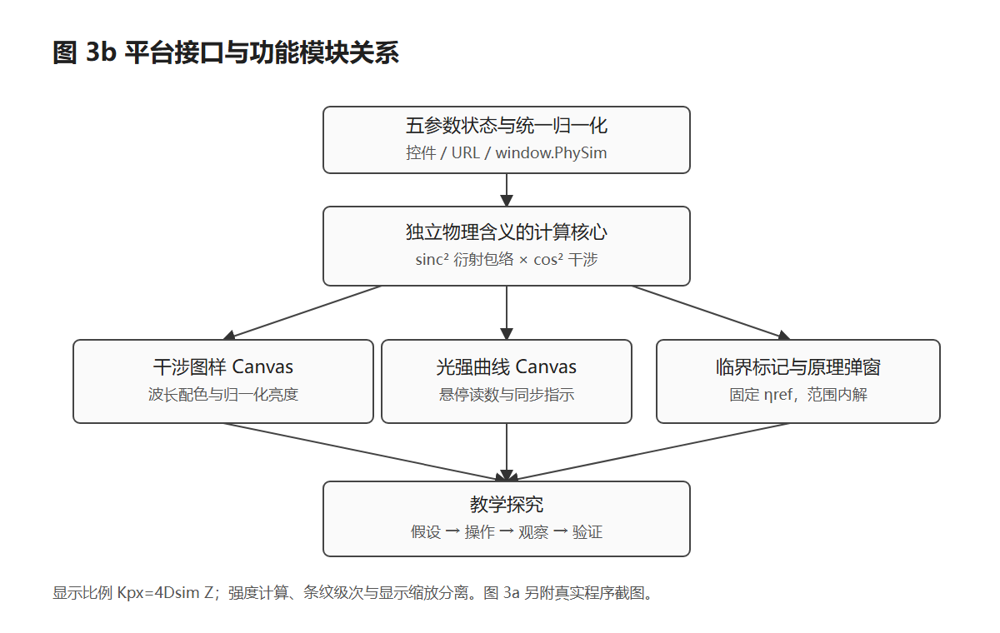

# 物理原理与程序模块

采用单色光、夫琅禾费远场近似，归一化强度为

`I_N(η)=sinc²(πaη/λ) · cos²(πdη/λ)`，其中 `sinc(t)=sin(t)/t`，`sinc(0)=1`。

λ、a、d 使用 nm；η 为归一化角坐标，近轴下 η≈x/D。物理距离 D 与屏幕显示比例分开：Canvas 上 `η=(u−u₀)/(4Dsim·Z)`。改变 Dsim 或 Z 只改变显示，不改变强度函数。

理想干涉亮条件 η=mλ/d；完整强度峰受单缝衍射包络调制。二级实际峰位约 0.2167724951，默认参数下峰值约 0.5777871859；相邻暗纹定义的中央与二级宽度均约 0.11。缺级另列，不将旁瓣作为缺失级次的峰。

控件、URL 与 `window.PhySim.setParams()` 共用归一化：非有限数回默认值，越界夹到范围内，a≤d。两个 Canvas 使用同一物理核心与同一水平坐标。

[返回课堂入口](../README.md)
